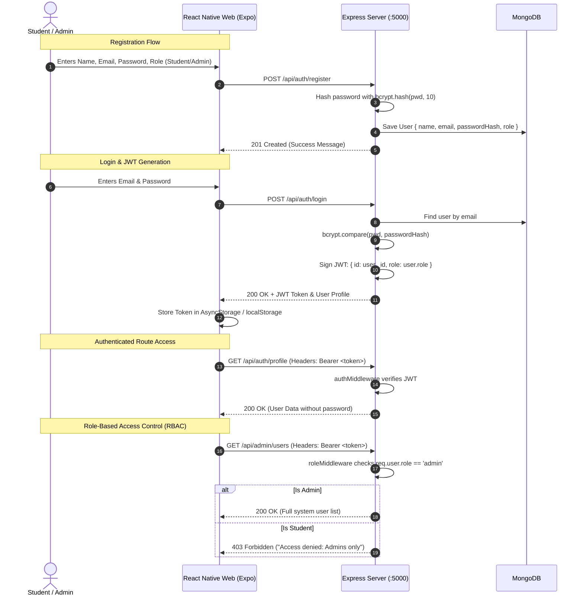

# Implementation Plan: Full Stack User Authentication System

> **Subject:** Full Stack Development (5th Sem BCA)  
> **Backend:** Node.js, Express, MongoDB (Mongoose), JWT, Bcrypt  
> **Frontend:** React Native for Web (Expo Web), Modern Minimalist UI  
> **Key Capabilities:** Registration, Secure Password Hashing, JWT Authentication, Protected Profile, Role-Based Access Control (`student` vs `admin`)

---

## 1. UI/UX Design System Specification (Minimal & Modern)

To ensure the web app looks polished, neat, aligned, and professional during project presentation and evaluation, the frontend adheres to a strict minimalist design specification:

### 1.1 Typography & Font Scale
* **Typeface:** System Sans-Serif stack (`-apple-system, BlinkMacSystemFont, "Segoe UI", Roboto, "Inter", Helvetica, Arial, sans-serif`) for crisp rendering on high-DPI screens.
* **Hierarchy:**
  * **Display / Title:** 24px, Bold (`700`), letter-spacing: `-0.5px`, line-height: 32px.
  * **Section Header:** 18px, SemiBold (`600`), letter-spacing: `-0.2px`, line-height: 24px.
  * **Body / Form Labels:** 14px, Medium (`500`), letter-spacing: `0px`, line-height: 20px.
  * **Input Text & Button:** 15px, Regular/SemiBold (`400`/`600`), line-height: 22px.
  * **Caption / Helper / Error:** 12px, Regular (`400`), letter-spacing: `0.1px`, line-height: 16px.

### 1.2 Color Palette
* **Canvas / Background:** `#F8FAFC` (Slate 50 — clean, distraction-free neutral backdrop)
* **Surface / Card:** `#FFFFFF` (Pure white card surfaces with crisp subtle borders)
* **Borders / Dividers:** `#E2E8F0` (Slate 200 — 1px hairline borders, no heavy shadows)
* **Primary Text:** `#0F172A` (Slate 900 — deep readable slate)
* **Secondary / Muted Text:** `#64748B` (Slate 500 — subtle guidance text)
* **Primary Brand / Action:** `#2563EB` (Royal Blue) or `#0F172A` (Monochrome Minimalist Black)
* **Role Badges:**
  * **Student:** `#F0FDF4` bg with `#166534` text & `#BBF7D0` border (Emerald)
  * **Admin:** `#FAF5FF` bg with `#6B21A8` text & `#E9D5FF` border (Purple)
* **Alerts / Validation:**
  * **Error:** `#FEF2F2` bg with `#991B1B` text & `#FECACA` border
  * **Success:** `#F0FDF4` bg with `#166534` text & `#BBF7D0` border

### 1.3 Layout & Structural Alignment
* **Form Container:** Centered card, constrained to `max-width: 440px`, with `padding: 32px` on desktop/web viewports.
* **Border Radius:** Standardized `12px` (`rounded-xl`) across cards, inputs, and buttons.
* **Vertical Rhythm:** Strict 8px baseline grid (spacing steps: 8px, 16px, 24px, 32px).
* **Elevations:** Subtle soft ambient shadow: `boxShadow: '0 4px 6px -1px rgba(0, 0, 0, 0.05), 0 2px 4px -2px rgba(0, 0, 0, 0.05)'`.

---

## 2. System Architecture & Flow

---

## 3. Phased Implementation Plan

### Phase 1: Backend Infrastructure (Express + MongoDB)

#### Task 1.1: Project Scaffolding & Dependencies
* **Files:**
  * Create: `backend/package.json`
  * Create: `backend/.env`
  * Create: `backend/server.js`
* **Dependencies:** `express`, `mongoose`, `dotenv`, `cors`, `bcryptjs`, `jsonwebtoken`.
* **Details:** Configure Express with JSON parsing and CORS enabled for the React Native Web origin (`http://localhost:8081` / `http://localhost:19006`).

#### Task 1.2: Database Connection
* **Files:**
  * Create: `backend/config/db.js`
* **Details:** Modular Mongoose connection logic with clear terminal success/error logging.

#### Task 1.3: User Model Schema
* **Files:**
  * Create: `backend/models/User.js`
* **Schema Definition:**
  * `name`: `{ type: String, required: true, trim: true }`
  * `email`: `{ type: String, required: true, unique: true, lowercase: true, trim: true }`
  * `password`: `{ type: String, required: true, minlength: 6 }`
  * `role`: `{ type: String, enum: ['student', 'admin'], default: 'student' }`
  * `createdAt` & `updatedAt` via `{ timestamps: true }`
* **Pre-save Hook:** Encrypt password using `bcryptjs` before persisting if modified.

#### Task 1.4: Auth Controller & Routes
* **Files:**
  * Create: `backend/controllers/authController.js`
  * Create: `backend/routes/authRoutes.js`
* **Endpoints:**
  * `POST /api/auth/register`: Validate inputs, check duplicates, create record.
  * `POST /api/auth/login`: Authenticate credentials, sign JWT with 24h expiry.
  * `GET /api/auth/profile`: Return authenticated user info (id, name, email, role, joined date).

#### Task 1.5: Authentication & Authorization Middleware
* **Files:**
  * Create: `backend/middleware/authMiddleware.js`
* **Middleware Functions:**
  * `protect`: Verifies `Authorization: Bearer <token>`, decodes payload, attaches `req.user`.
  * `authorize(...roles)`: Verifies `roles.includes(req.user.role)`, responds with `403` if unauthorized.

#### Task 1.6: Admin-Only Route (Demonstrating Role-Based Access)
* **Files:**
  * Create: `backend/routes/adminRoutes.js`
  * Create: `backend/controllers/adminController.js`
* **Endpoints:**
  * `GET /api/admin/users`: Protected by `protect` and `authorize('admin')`. Returns a list of all users and their assigned roles.

---

### Phase 2: Frontend Setup & Minimalist Component Library

#### Task 2.1: React Native Web / Expo Project Initialization
* **Files:**
  * Directory: `frontend/`
* **Tooling:** Initialize via `npx create-expo-app frontend --template blank`.
* **Libraries:** `@react-native-async-storage/async-storage`, `axios`.

#### Task 2.2: Design Tokens & Typography
* **Files:**
  * Create: `frontend/src/theme/colors.js`
  * Create: `frontend/src/theme/typography.js`
  * Create: `frontend/src/theme/spacing.js`
* **Details:** Centralize slate palette, font weights, paddings, and border radiuses.

#### Task 2.3: Reusable Minimalist UI Components
* **Files:**
  * Create: `frontend/src/components/Card.js` (Surface card with border and clean padding)
  * Create: `frontend/src/components/InputField.js` (Label, focus border transition, helper/error text)
  * Create: `frontend/src/components/Button.js` (Primary/Secondary styles with loading spinner indicator)
  * Create: `frontend/src/components/Badge.js` (Student vs Admin colored tag)
  * Create: `frontend/src/components/SegmentedControl.js` (Minimalist toggle for selecting `Student` vs `Admin` during registration)

---

### Phase 3: Auth State Management & Client API Layer

#### Task 3.1: Axios HTTP Client with Interceptors
* **Files:**
  * Create: `frontend/src/api/client.js`
* **Details:** Configure baseURL (`http://localhost:5000/api`). Auto-inject stored JWT into `Authorization` headers. Intercept `401 Unauthorized` responses to trigger auto-logout.

#### Task 3.2: Authentication Context & Persistent Session
* **Files:**
  * Create: `frontend/src/context/AuthContext.js`
* **Capabilities:**
  * `login(email, password)`
  * `register({ name, email, password, role })`
  * `logout()`
  * Auto-restore session from `AsyncStorage` on app launch.

---

### Phase 4: Screen Implementation

#### Task 4.1: Login Screen (`src/screens/LoginScreen.js`)
* Centered card layout.
* Clean inputs for Email and Password.
* "Sign In" button with loading state.
* Switcher to Register view.
* Inline feedback for wrong credentials.

#### Task 4.2: Register Screen (`src/screens/RegisterScreen.js`)
* Full Name, Email, Password.
* Role Selector: Toggle between **Student** and **Admin** (with clear explanation of access privileges).
* Direct link back to Login.

#### Task 4.3: User Profile & Role Dashboard (`src/screens/ProfileScreen.js`)
* **Header:** Greeting, user name, and Role Badge (`Student` or `Admin`).
* **Profile Details Card:** Clean tabular/grid display of User ID, Email, Role, Account Created timestamp.
* **Role Verification Showcase:**
  * An interactive **"Fetch Admin Directory"** button:
    * If logged in as **Admin**: Displays the complete list of users and active accounts.
    * If logged in as **Student**: Triggers the protected endpoint and displays the actual backend `403 Forbidden` message to prove RBAC is enforced server-side.
* **Logout Button:** Minimalist danger/outline action that clears storage and returns to Login.

---

### Phase 5: Verification, Testing & Academic Presentation Checklist

* [ ] **Password Hashing:** Inspect MongoDB directly to confirm passwords are saved as `$2a$10$...` hashes, never plain text.
* [ ] **JWT Payload Validation:** Verify token generation with valid claims (`id`, `role`, `exp`).
* [ ] **Protected Endpoint Security:** Verify `GET /api/auth/profile` returns `401 Unauthorized` without a token.
* [ ] **Role Access Enforcement:** Verify `GET /api/admin/users` allows `admin` and blocks `student` with `403 Forbidden`.
* [ ] **Cross-Platform Web Layout:** Verify card is properly centered, typography is legible, inputs handle tab navigation, and responsive padding looks sharp on both desktop browser and mobile viewport.
* [ ] **Documentation / README:** Provide quick setup instructions (`npm run server` and `npm run web`), test accounts, and route references for project submission.
